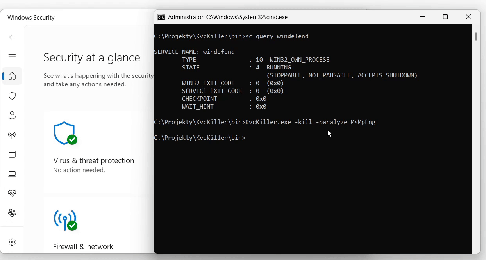
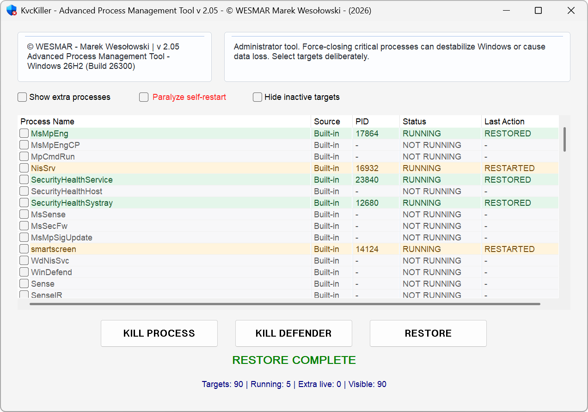
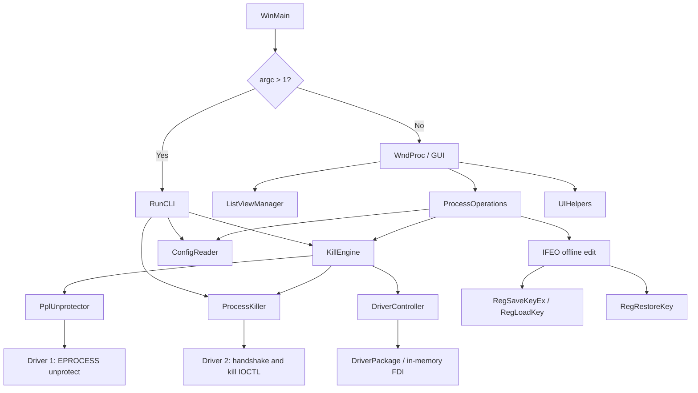
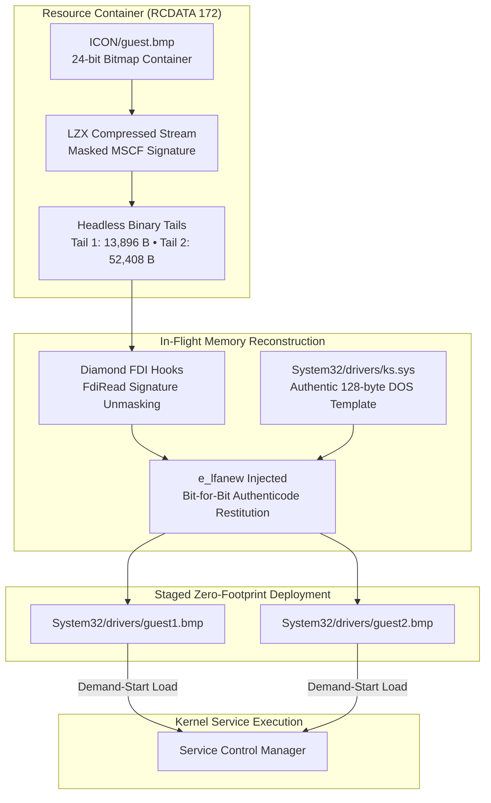
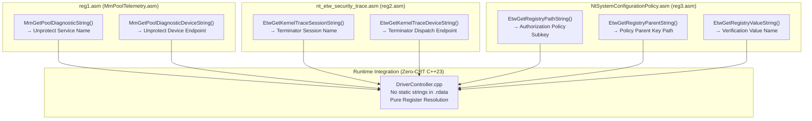
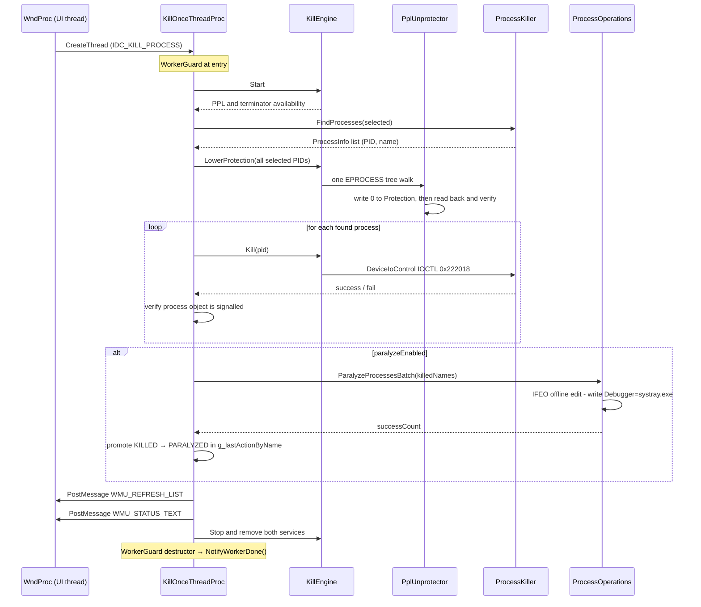
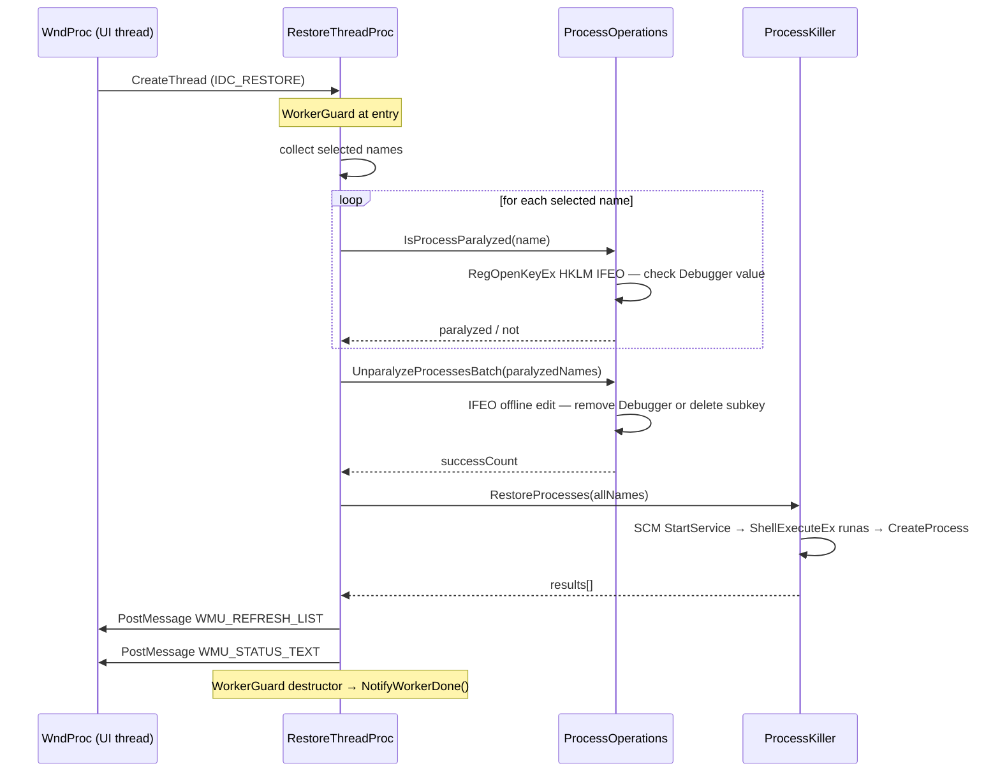

<div align="center">

# KvcKiller

**Advanced Process Management Tool for Windows x64**

Kernel-mode AV/EDR process termination · IFEO Paralyze · SCM Restore · Headless CLI


[](LICENSE.md)

[**Download KvcKiller.7z**](../../releases/latest/download/KvcKiller.7z) &nbsp;·&nbsp; Password: `github.com`

</div>

<div align="center">

**CLI — terminal demo**



**GUI — main window**



</div>

---

## What's New - 10.11.2026 (v2.0.5)

The **KvcKiller 2.0.5** release introduces a steganographic carrier architecture, a 1/70 static detection profile on VirusTotal at the time of publication, and a triple MASM x64 Macro Assembler pipeline, eliminating static binary signatures and readable strings across executable sections:

- **Steganographic 24-Bit Pixel Matrix (`guest.bmp`)** — Kernel-mode binaries have their 128-byte DOS MZ headers severed and are bundled into a headless binary stream compressed into an LZX Cabinet with a masked `MSCF` signature. The resulting blob is embedded directly into the pixel array of a legitimate 24-bit bitmap (`ICON\guest.bmp`, RCDATA 172). To static inspection and automated AV heuristics, the resource presents as benign visual noise, resulting in an exceptional 1/70 detection score on VirusTotal.

<div align="center">


<sub><em>The binary armorer — just an innocent image</em></sub>

</div>

- **In-Flight FDI Stream Decompression & Authentic DOS Stub Inheritance** — Custom Diamond FDI hooks unmask the `MSCF` header in memory during stream read, decompress the payload in RAM, borrow an authentic, digitally-signed 128-byte DOS header from system `ks.sys` (resolved dynamically via `GetSystemDirectoryW`), patch offset `0x3C` (`e_lfanew`), and reconstruct both signed ring-0 modules bit-for-bit without temporary intermediate files.
- **Staged Masquerade as `guest1.bmp` and `guest2.bmp`** — Reconstructed modules are staged to `System32\drivers` using neutral `.bmp` image extensions instead of traditional `.sys`. The kernel loader processes binaries based on internal PE structures rather than extensions, bypassing simple directory file-creation heuristics. Staged files are deleted immediately after execution.
- **Triple MASM x64 Macro Assembler Pipeline (`reg1.asm`, `reg2.asm`, `reg3.asm`)** — All device names, diagnostic sessions, and WOW64 registry paths are distributed across three distinct assembly translation units. Each routine features an atomic lock-free spin-lock and reconstitutes target wide strings in CPU registers within a few clock cycles (XOR + `rol 4` bitwise rotation + delta subtraction). The binary `.rdata` section contains zero plaintext footprint.
- **Enforced Data Alignment (`ALIGN 8`)** — Eliminates `STATUS_DATATYPE_MISALIGNMENT` (Win32 Error 998 / `ERROR_NOACCESS`), which occurs during kernel `NtOpenKey` dispatches when wide-string buffers are misaligned in memory.

---

## Table of Contents

- [Feature Overview](#feature-overview)
- [Architecture](#architecture)
- [Steganographic Packaging & Ring-0 Deployment](#steganographic-packaging--ring-0-deployment)
- [Triple MASM x64 Macro Assembler Architecture](#triple-masm-x64-macro-assembler-architecture)
- [A Word for Analysts and Cloners](#a-word-for-analysts-and-cloners)
- [Kill Flow](#kill-flow)
- [Paralyze: IFEO Offline Editing](#paralyze-ifeo-offline-editing)
  - [What IFEO Does](#what-ifeo-does)
  - [Why Direct IFEO Write Fails](#why-direct-ifeo-write-fails)
  - [The Offline Hive Editing Trick](#the-offline-hive-editing-trick)
  - [The MsMpEng Phenomenon](#the-msmpeng-phenomenon)
- [Restore Flow](#restore-flow)
- [Built-in Target List](#built-in-target-list)
- [GUI Reference](#gui-reference)
- [CLI Reference](#cli-reference)
- [Registry & Configuration](#registry--configuration)
- [Zero-CRT Architecture (Modern C++23)](#zero-crt-architecture-modern-c23)
- [Module Map](#module-map)
- [Build](#build)
- [Kernel Components](#kernel-components)
- [System Requirements](#system-requirements)

---

## Feature Overview

KvcKiller terminates AV/EDR processes that protect themselves against user-space
`TerminateProcess` calls by dispatching kills through a kernel driver via `DeviceIoControl`.
Self-protection at ring 3 is irrelevant when the termination signal arrives from ring 0.

### Kill Engine

- **Dual kernel pipeline** — the first component exposes kernel memory primitives and lowers
  the target's `EPROCESS` protection; the second component sends the termination request for
  the now-unprotected process
- **Two independent services** — `KvcPplUnprotect` and `KvcProcessKill` are demand-start
  services loaded from `guest1.bmp` and `guest2.bmp` in `System32\drivers`
- **Steganographic Driver Package** — both driver images have their 128-byte MZ/DOS headers
  stripped, combined into a headless binary stream packed as `guest.bmp`, compressed into an LZX Cabinet with
  obfuscated `MSCF` magic headers, and wrapped as pixel data in a valid 24-bit bitmap (`ICON\guest.bmp`). The runtime
  extracts the CAB from the BMP in memory, unmasks `MSCF` in-flight via FDI stream callbacks, borrows the legitimate
  128-byte DOS template from `ks.sys` (resolved dynamically via `GetSystemDirectoryW`), patches byte `0x3C` (`e_lfanew`),
  and reconstructs both signed drivers bit-for-bit in memory before staging as `guest1.bmp` and `guest2.bmp`. Zero PE
  headers and zero archival magic signatures exist in the binary image.
- **Fail-safe sequencing** — a PPL write is accepted only after a read-back confirms the
  protection byte is zero. If the kernel termination request is rejected, the engine attempts
  a user-mode `TerminateProcess` fallback
- **Deterministic cleanup** — both handles are closed, both services are stopped and deleted,
  the temporary caller verification registry value is restored, and both staged files are removed

### Paralyze Mode

- Injects `Debugger = C:\Windows\System32\systray.exe` into **Image File Execution Options**
  for each target process — Windows intercepts every subsequent launch and runs the dummy
  debugger instead; no AV code ever executes
- `systray.exe` is chosen deliberately: it is a legitimate system binary (Windows System Tray
  host), carries a Microsoft signature, and exits silently when invoked with unexpected
  arguments — making the interception less suspicious than a non-existent path
- Survives application restart: on next launch, KvcKiller reads IFEO and restores the
  **PARALYZED** state in the UI without any separate persistence file
- Reversed by Restore — the IFEO entry is removed before the service is restarted
- Temp files created during the offline hive edit (`C:\Windows\Temp\Ifeo.hiv`,
  `.LOG1`, `.LOG2`, `.blf`, `*.regtrans-ms`) are cleaned up after each operation

### Restore

- Removes the IFEO Debugger entry (unparalyze) before any launch attempt
- Restarts via **SCM StartService** → **ShellExecuteEx (runas)** → direct **CreateProcess**
- Batch restore for all selected targets; path resolved from live
  `QueryFullProcessImageNameW` or HKCU path cache

### GUI

- Win32 ListView with 5 columns (Process Name, Source, PID, Status, Last Action),
  click-to-sort
- Dark / light mode auto-detected; DWM **Mica backdrop** and rounded corners on Windows 11;
  **Per-Monitor-V2** layout, fonts, columns, and minimum window size; animated
  **sine-pulse** Paralyze label
- **PARALYZED** row state: orange color, distinct from red KILLED, persists across restarts
- **KILL DEFENDER** handles `MsMpEng`, `SecurityHealthService`, and
  `SecurityHealthSystray` as one action without changing the user's checked rows
- Filters use full measured labels and wrap to another row when the window is too narrow
- "Show extra processes" appends running processes outside the target list
- "Hide inactive targets" collapses not-running entries with no pending action
- Worker threads for kill and restore; atomic shutdown coordination; UI stays responsive

### CLI

Single binary, dual mode — GUI when launched without arguments, headless console tool with
arguments. No separate CLI binary.

---

## Architecture



```
WinMain
  ├─ argc > 1  →  RunCLI (headless, AttachConsole)
  └─ GUI mode
       ├─ WndProc
       │    ├─ WM_CREATE     →  InitListView, RefreshProcessList, timers
       │    ├─ WM_COMMAND    →  KillOnceAction / RestoreAction (worker threads)
       │    ├─ WM_NOTIFY     →  HandleListCustomDraw, sort on LVN_COLUMNCLICK
       │    ├─ WM_CLOSE      →  set g_shutdownPending; defer DestroyWindow if workers active
       │    └─ WM_PAINT      →  PaintHeaderPanels (custom rounded rects)
       ├─ UIHelpers           (fonts, dark mode, Mica, DPI-aware layout)
       ├─ ListViewManager     (columns, custom draw, row flag bits, IFEO cold-start check)
       ├─ ProcessOperations   (worker threads, batch protection, IFEO paralyze/unparalyze)
       ├─ KillEngine          (dual-driver session, ordered kill, verification, fallback)
       ├─ PplUnprotector      (offset discovery, EPROCESS walk, protection-byte update)
       ├─ ProcessKiller       (discovery, terminator IOCTL, restoration)
       ├─ DriverController    (two SCM services, device handles, configuration, cleanup)
       ├─ DriverPackage       (steganographic guest image, template assembly)
       └─ ConfigReader        (HKCU registry: target list, path cache, history ring buffer)
```

### Thread Model

Worker threads (`KillOnceThreadProc`, `RestoreThreadProc`) are created via `CreateThread` from
`WM_COMMAND`. `g_activeWorkers` (atomic int) counts live workers; `g_shutdownPending` (atomic
bool) signals them to exit cleanly. `WM_CLOSE` defers `DestroyWindow` until
`g_activeWorkers == 0` — the window never closes mid-operation. The last worker to exit during
shutdown re-posts `WM_CLOSE` to unblock the message loop.

A `WorkerGuard` RAII struct placed at the top of every thread proc guarantees
`g_activeWorkers` is decremented on all exit paths, including early returns and exception
unwinds.

Cross-thread UI updates use `PostMessage(WMU_STATUS_TEXT)` with a heap-allocated
`std::wstring*`; the message handler owns and deletes it. The paralyze checkbox state is read
on the UI thread in `KillOnceAction` and passed to the worker via `KillThreadParams` — no
cross-thread `SendMessage` is needed.

`g_lastActionByName` and `g_prevRunningByName` are guarded by `g_statusLock`
(`CRITICAL_SECTION`).

---

## Steganographic Packaging & Ring-0 Deployment

The ring-0 payload delivery architecture in KvcKiller 2.0.5 was engineered to scatter binary signatures and strip all recognizable Portable Executable characteristics prior to service loading.



### 1. Fragmented Pixel Matrix and the Appearance of Visual Chaos

Rather than embedding raw binaries, both digitally signed ring-0 modules have their initial 128-byte DOS MZ headers excised. This strips the PE structure into an unstructured byte sequence that evades signature-matching heuristics, producing two headless binary tails:
- $kTail_1$ (13,896 bytes) — PPL privilege revocation component,
- $kTail_2$ (52,408 bytes) — process termination component.

The combined headless stream is compressed using the LZX algorithm in Microsoft Cabinet format (`guest.bmp`). The initial 4 magic bytes (`MSCF`) are masked with a 32-bit XOR key:
`[0xA5, 0x5A, 0xF0, 0x0F]` $\to$ `[0xE8, 0x09, 0xB3, 0x49]`.

The obfuscated archive is embedded directly into the pixel array of an uncompressed 24-bit bitmap (`ICON\guest.bmp`), linked as resource `RCDATA 172`. To static scanners, YARA rules, and PE resource editors (such as Resource Hacker), the data presents as a standard, well-formed Windows bitmap whose pixel array appears to be pseudorandom visual noise.

<div align="center">


<sub><em>The binary armorer — just an innocent image (guest.bmp, 108×108 24-bit RGB)</em></sub>

</div>

### 2. In-Flight Memory Reconstruction and Borrowed DOS Template

During initialization, the [`DriverPackage`](file:///C:/Projekty/KvcKiller/src/DriverPackage.cpp) engine:
1. Maps `guest.bmp` directly from process memory using `FindResourceW` / `LockResource`.
2. Locates the pixel array offset (`bfOffBits = 54`) and total stream size from the bitmap file header.
3. Initializes the Diamond FDI decompression engine (`Cabinet.dll`) with custom in-memory stream callbacks. The `FdiRead` callback dynamically unmasks the `MSCF` signature bytes on the fly during the first read transaction.
4. Borrows an authentic, digitally-signed 128-byte DOS header template from the system's own `System32\drivers\ks.sys` (dynamically located via `GetSystemDirectoryW`, independent of hardcoded drive letters).
5. Injects the corresponding PE header pointer at offset `0x3C` (`e_lfanew` = `0xC8` for module 1, `0xF0` for module 2) and joins the template with the headless tails. This restitutes both fully functional, signature-valid kernel modules in RAM with zero disk operations.

### 3. Staged Deployment under BMP Masquerade (`guest1.bmp`, `guest2.bmp`)

The reconstructed ring-0 binaries are written to `C:\Windows\System32\drivers\` under neutral filenames: `guest1.bmp` and `guest2.bmp`. The kernel-mode Service Control Manager loads executables according to their internal PE structure regardless of file extension. Using an image file extension instead of `.sys` evades file-creation monitoring rules focused on executable paths. Once execution finishes, services are deleted and both staged files are immediately scrubbed from disk.

---

## Triple MASM x64 Macro Assembler Architecture

To eliminate all human-readable ASCII/Unicode strings (device paths, session identifiers, WOW64 registry paths), KvcKiller employs a three-module pure x64 macro assembly architecture (Microsoft Macro Assembler — ML64), integrated into the MSBuild pipeline:



### 1. Separation of Concerns in Macro Assembler
- [`src/reg1.asm`](file:///C:/Projekty/KvcKiller/src/reg1.asm) — Camouflaged as a kernel pool memory telemetry module (`MmPoolTelemetry.asm`). Dynamically decodes service identifiers and device endpoints for the unprotect component.
- [`src/reg2.asm`](file:///C:/Projekty/KvcKiller/src/reg2.asm) — Camouflaged as an ETW kernel security trace provider (`nt_etw_security_trace.asm`). Decodes diagnostic trace sessions and the termination dispatch endpoint.
- [`src/reg3.asm`](file:///C:/Projekty/KvcKiller/src/reg3.asm) — Camouflaged as an NT system configuration policy unit (`NtSystemConfigurationPolicy.asm`). Decodes registry hives and authorization value names for the termination subsystem.

### 2. Transformation Logic & Lock-Free Atomic Spin-Lock
Each string is stored as an array of encoded 16-bit words (`dw`). Decoding runs entirely inside CPU registers within a few instructions:
$$\text{Character}[i] = ((\text{Word}[i] \oplus \text{Seed}) \lll 4) - \Delta$$

Buffer access is synchronized with a lock-free atomic spin-lock using states `0` (uninitialized), `1` (decoding in progress), and `2` (ready for immediate read), paired with the `pause` instruction. Decoding executes strictly once on initial invocation; subsequent calls return the buffer pointer in two instructions (`lea rax, [buf]; ret`).

### 3. Strict 8-Byte Buffer Alignment (`ALIGN 8`)
All UTF-16LE output buffers enforce an `ALIGN 8` directive. This prevents a critical kernel failure: calling `NtOpenKey` or `RegOpenKeyExW` with an odd or unaligned memory pointer triggers `STATUS_DATATYPE_MISALIGNMENT` in the kernel executive, reported to user space as Win32 Error `998` (`ERROR_NOACCESS`). Explicit quadword alignment in MASM ensures reliable API interoperability.

---

## A Word for Analysts and Cloners

> [!NOTE]
> The obfuscation and steganographic delivery techniques used here are not "rocket science" or mystical high-flown academic theory — they represent deliberate low-level craftsmanship grounded in the pragmatic realities of the x64 architecture and Windows PE internals.
>
> Because the complete source code, macro assembly units, and architectural breakdowns are provided openly in this repository, dissecting or reproducing this implementation in hindsight is trivial. Yet, the underlying engineering paradigm illustrates why pure low-level design is so potent: sub-cycle register transformations, atomic lock-free spin-locks, a zero-CRT footprint, and headless pixel-array steganography combine to deliver formidable execution performance while keeping static heuristic scanners completely blind — long before signature-based detection systems catch on.
>
> Without the source code at hand and without the aid of modern AI tools, any static analyst or reverse engineer facing the compiled binary alone would easily find themselves tangled in the maze of severed DOS headers, fragmented pixel matrices, and in-flight FDI memory reconstruction. In systems engineering, subtle, native mechanics often prove far more resilient and enduring than bloated, generic protectors.

---

## Kill Flow



| Step | Detail |
|------|---------|
| **Discovery** | `CreateToolhelp32Snapshot(TH32CS_SNAPPROCESS)` + `Process32FirstW/NextW`; matched by base exe name, case-insensitive |
| **Offsets** | `PsInitialSystemProcess`, `PsGetProcessId`, and both protection predicates are resolved from the mapped `ntoskrnl.exe`; ambiguous patterns abort the kernel-write phase |
| **Unprotect** | driver 1 reads the `EPROCESS.ActiveProcessLinks` list once for the complete selected PID batch, writes the protection byte only when non-zero, and verifies the zero value |
| **Handshake** | `DeviceIoControl(0x00222008)` with `0x77777777`; a reply of `1` marks driver 2 ready |
| **Kill** | `DeviceIoControl(0x00222018)` sends one `DWORD` PID and reads the kernel `NTSTATUS` |
| **Confirmation** | `IsProcessRunning(pid)` via `WaitForSingleObject` after the request, with a user-mode fallback only if the kernel request was rejected |
| **State** | `g_lastActionByName[key] = kActionKilled`; promoted to `kActionParalyzed` if IFEO write succeeded |

---

## Paralyze: IFEO Offline Editing

### What IFEO Does

**Image File Execution Options** (`HKLM\SOFTWARE\Microsoft\Windows NT\CurrentVersion\Image
File Execution Options`) is a Windows mechanism originally designed for attaching a debugger to
a process at startup. When a `Debugger` value is present under a process's IFEO subkey, the
Windows loader (`ntdll!LdrpInitializeProcess`) checks for it before transferring control to
the image entry point. If found, it launches the registered debugger binary with the original
command line appended — and the original process never runs.

KvcKiller writes `Debugger = C:\Windows\System32\systray.exe`. When the AV service manager
issues `StartService`, the Windows loader intercepts the launch and runs `systray.exe` instead.
`systray.exe` is the System Tray notification area host — when invoked with unexpected
arguments it exits immediately. From SCM's perspective the service "started and exited with
code 0", which does not trigger service recovery restart logic. No AV code executed.

`systray.exe` is chosen over a non-existent path or a custom binary because it:
- Carries a valid Microsoft Authenticode signature
- Is present on every Windows installation
- Exits cleanly without error dialogs or event log entries

### Why Direct IFEO Write Fails

Attempting to write `Debugger` directly to a live IFEO subkey with `RegSetValueExW` returns
`ERROR_ACCESS_DENIED` (error 5), even from an Administrator process with both
`SeRestorePrivilege` and `SeBackupPrivilege` enabled.

The root cause is the DACL on individual IFEO subkeys. On Windows 10/11, Microsoft tightens
the ACLs on IFEO entries for Defender components (`MsMpEng.exe`, `NisSrv.exe`, etc.) so that
only `NT AUTHORITY\SYSTEM` and `NT SERVICE\TrustedInstaller` hold write access. Security
vendors (CrowdStrike, SentinelOne, ESET, Kaspersky) extend this by adding explicit deny ACEs
for their own IFEO entries as part of their self-protection stack — blocking writes even from
a TrustedInstaller-impersonating token, since TrustedInstaller SID must appear in the DACL
grant specifically for each subkey.

**The core problem: you cannot reliably write `Debugger` to live IFEO for protected processes
regardless of privilege level.** Privilege escalation is a dead end here because the ACLs
are evaluated per-key, not per-privilege.

### The Offline Hive Editing Trick

The solution is to never touch the live IFEO key directly. Instead:

```
Step 1 — RegSaveKeyEx
  Save HKLM\...\Image File Execution Options → C:\Windows\Temp\Ifeo.hiv

  Reads the entire IFEO subtree into a flat hive file on disk.
  Requires SE_BACKUP_NAME — backup privilege bypasses DACL on read.
  The per-subkey ACLs that blocked direct writes are irrelevant here.

Step 2 — RegLoadKey
  Load Ifeo.hiv → HKLM\TempIFEO

  Mounts the saved hive file as a new root key under HKLM.
  Critically: the mounted key's effective DACL is inherited from the
  parent HKLM node, NOT from the original IFEO subkey ACLs.
  The calling Administrator process has full KEY_ALL_ACCESS on TempIFEO.

Step 3 — Edit offline
  RegCreateKeyExW / RegSetValueExW / RegDeleteKeyW on HKLM\TempIFEO\...

  All operations succeed — no ACL enforcement from original IFEO DACLs.
  The hive file is modified with the new Debugger entries.

Step 4 — RegUnLoadKey
  Unmount HKLM\TempIFEO

  Flushes all changes to Ifeo.hiv and releases the mount.

Step 5 — RegRestoreKey (REG_FORCE_RESTORE)
  Restore Ifeo.hiv → HKLM\...\Image File Execution Options

  Atomically replaces the entire live IFEO subtree with the modified hive.
  REG_FORCE_RESTORE overrides the target key's DACL for this operation.
  Requires SE_RESTORE_NAME.

Step 6 — Cleanup
  Delete C:\Windows\Temp\Ifeo.hiv, Ifeo.hiv.LOG1, Ifeo.hiv.LOG2,
         Ifeo.hiv.blf, *.regtrans-ms
```

This approach works because `RegRestoreKey` with `REG_FORCE_RESTORE` is a legitimate
backup/restore API that predates Windows NT 4.0. The `SE_BACKUP_NAME` + `SE_RESTORE_NAME`
privilege pair is intentionally granted to Administrator accounts to allow system backup
software (Veeam, VSS, Windows Backup) to preserve and restore registry hives without DACL
interference. Microsoft cannot restrict these privileges without breaking every backup solution
on Windows.

**IFEO ownership tracking:** A value under `HKCU\Software\KvcKiller` records which IFEO
entries were created by KvcKiller (value name = `ProcessName.exe`, type `REG_DWORD`, data `1`)
versus which already existed. On unparalyze, only KvcKiller-created subkeys are deleted
entirely; for pre-existing subkeys, only the `Debugger` value is removed. This avoids
destroying legitimate IFEO entries placed by other tools.

### The MsMpEng Phenomenon

`MsMpEng.exe` (Windows Defender's antimalware engine) is the canonical demonstration case for
why Paralyze is necessary alongside Kill.

After a kernel-mode kill, `WinDefend` (the Defender service) detects that `MsMpEng.exe` exited
and issues `StartService` within milliseconds. Additionally:

- `SecurityHealthService` monitors Defender health and can trigger restarts independently
- `WdNisSvc` (Network Inspection Service) shares a service group and influences restart timing
- SCM service recovery settings for `WinDefend` specify immediate restart on failure
- On Windows 11, Defender processes carry **PPL-Antimalware** (Protected Process Light) flags

Without Paralyze, `MsMpEng.exe` is back within 1–3 seconds of the kill. With Paralyze:

1. KvcKiller sends the IOCTL kill — `MsMpEng.exe` is terminated at ring 0
2. `WinDefend` calls `StartService` → loader checks IFEO →
   finds `Debugger = systray.exe` → runs `systray.exe` → exits with code 0
3. SCM records "service started and exited normally" — recovery restart logic does not trigger
4. `SecurityHealthService` sees a clean exit, does not escalate
5. Defender stays dead until Restore explicitly removes the IFEO entry and calls `StartService`

The same mechanism works for CrowdStrike (`CSFalconService`), SentinelOne (`SentinelAgent`),
ESET (`ekrn`), Kaspersky (`avp`), and all other AV/EDR engines that restart via SCM — because
it targets the **Windows loader**, not the service manager. The loader always checks IFEO
before transferring control, regardless of how the process was started.

---

## Restore Flow



`ProcessKiller::RestoreProcesses` tries three methods in order, stopping at the first success:

| Method | When used |
|--------|-----------|
| **SCM StartService** | Process is registered as a Win32 service (covers most AV/EDR) |
| **ShellExecuteEx** with `runas` | GUI apps and self-elevating executables |
| **CreateProcess** | Fallback using the HKCU path cache |

The executable path is resolved from (priority order):
1. Live `QueryFullProcessImageNameW` on the running PID — updated on every refresh cycle
2. `ConfigReader::ReadProcessPath` from the HKCU path cache
3. `QueryServiceConfigW` → `lpBinaryPathName` from the SCM service entry

`IsProcessParalyzed` reads `HKLM\...\Image File Execution Options\<name.exe>\Debugger` directly
at restore time, so the correct unparalyze path is taken even when the PARALYZED state was set
in a previous session.

---

## Built-in Target List

Compiled into the binary as `IDR_DEFAULT_TARGETS RCDATA "KvcKiller.ini"` and written to HKCU
on first run. The resource loader handles three encodings automatically: **UTF-16 LE with BOM**
(direct cast), **UTF-8 with BOM** (skip 3-byte marker, convert via `MultiByteToWideChar`), and
**plain UTF-8 / ANSI** (CP_UTF8 first, fall back to `CP_ACP` if invalid sequence detected).

90+ targets across 15 vendors:

| Vendor | Processes |
|--------|-----------|
| **Microsoft Defender / Sentinel / Sense** | MsMpEng, MsMpEngCP, MpCmdRun, NisSrv, SecurityHealthService, SecurityHealthHost, SecurityHealthSystray, MsSense, MsSecFw, MsMpSigUpdate, smartscreen, WdNisSvc, WinDefend, Sense, SenseIR, SenseCncProxy, MsColleciton, MpNWMon |
| **Avast / AVG** | AvastSvc, AvastUI, aswEngSrv, aswToolsSvc, avg, avgui, avgsvc, avgidsagent |
| **Bitdefender** | vsserv, bdservicehost, bdagent, bdwtxag, updatesrv, bdredline, bdscan, seccenter |
| **Carbon Black (VMware)** | cb, RepMgr, RepUtils, RepWsc |
| **CrowdStrike** | CSFalconService, CSFalconContainer |
| **Cylance (BlackBerry)** | CylanceSvc, CylanceUI |
| **ESET** | ekrn, egui, ema_client, ekrnui, elam |
| **FireEye / Trellix** | xagt, FireEye |
| **Kaspersky** | avp, avpui, klnagent, kavfs, kavfsslp, kmon, ksde, kavtray |
| **Malwarebytes** | mbamservice, mbam, mbamtray |
| **McAfee** | McAfeeService, McAPExe, mcshield, mfemms, mfeann, mcagent, mctray |
| **Norton / Symantec** | ccSvcHst, nortonsecurity, symantec, Smc, SNAC, SymCorpUI |
| **SentinelOne** | SentinelAgent, SentinelMonitor, SentinelServiceHost, SentinelHelperService, SentinelBrowserNative |
| **Sophos** | SavService, SophosHealth, SophosCleanService, SophosFileScanner, SophosSafestore64, SophosMcsAgent, SophosEDR |
| **Trend Micro** | TMBMSRV, NTRTScan, TmListen, TmProxy, TmPfw |

Custom targets can be added to `HKCU\Software\KvcKiller\Targets` or by editing
`KvcKiller.ini` before first run.

---

## GUI Reference

### Window Layout

| Panel | Content |
|-------|---------|
| Header left | © WESMAR Marek Wesołowski · Advanced Process Management Tool – Windows 11 25H2 |
| Header right | Warning / status banner |
| **Process Name** · Source · PID · Status · Last Action | MsMpEng · Built-in · 4812 · RUNNING · `-` |
| | CylanceSvc · Built-in · — · NOT RUNNING · `KILLED` |
| | MsMpEng · Built-in · — · NOT RUNNING · `PARALYZED` |
| Checkboxes | ☐ Show extra processes · ☐ ~~~Paralyze self-restart~~~ · ☐ Hide inactive targets |
| Actions | `[KILL PROCESS]`  `[KILL DEFENDER]`  `[RESTORE]` |
| Footer | READY · 90 targets · 3 running · 2 extra |

### ListView Columns

| Column | Width | Description |
|--------|-------|-------------|
| **Process Name** | Flexible | Base executable name from `CreateToolhelp32Snapshot` |
| **Source** | 60 px | `Built-in` (from config) or `Saved` (extra, added dynamically) |
| **PID** | 68 px | Live PID; `—` when not running |
| **Status** | 118 px | `RUNNING` / `NOT RUNNING`; color-coded via `NM_CUSTOMDRAW` |
| **Last Action** | 120 px | `KILLED` / `PARALYZED` / `RESTORED` / `RESTARTED` / `LIVE` / `RESTORING` / `-` |

### Row Colors (NM_CUSTOMDRAW)

| State | Dark mode | Light mode |
|-------|-----------|------------|
| **RUNNING** | Green text / dark green bg | Green text / light green bg |
| **KILLED** | Red text / dark red bg | Dark red text / light red bg |
| **PARALYZED** | Orange text / dark orange bg | Dark orange text / light orange bg |
| **RESTORED / RESTARTED** | Blue text / dark blue bg | Blue text / light blue bg |
| **NOT RUNNING (no action)** | Gray text | Gray text |

PARALYZED is evaluated before KILLED in the custom draw chain — the more specific state wins.

### Row Flag Bits (LVITEM::lParam)

| Flag | Value | Meaning |
|------|-------|---------|
| `kRowFlagRunning` | 0x0001 | Process is currently running |
| `kRowFlagExtra` | 0x0002 | Not in config; added by "Show extra" |
| `kRowFlagKilled` | 0x0004 | Was killed this session |
| `kRowFlagRestored` | 0x0008 | Was restored this session |
| `kRowFlagRestarted` | 0x0010 | Restarted on its own after kill |
| `kRowFlagParalyzed` | 0x0020 | Killed and has IFEO Debugger entry blocking restart |

### PARALYZED State Persistence

PARALYZED is the only action state that persists across application restarts without a separate
persistence file. IFEO is the source of truth. On startup, `RefreshProcessList` calls
`IsProcessParalyzed(name)` for each not-running process with no stored action. If the IFEO
`Debugger` value is found, the row is initialised with `kActionParalyzed` and
`kRowFlagParalyzed`.

KILLED state is intentionally not persisted across restarts: when KvcKiller exits, the killed
process may already be restarting (or may have already come back up). Showing a stale KILLED
label on next launch without knowing actual current state would be misleading.

### Paralyze Label Animation

The Paralyze checkbox label pulses in red using a sine wave tied to `GetTickCount64`. A 40 ms
`WM_TIMER` invalidates only the label HWND; `WM_CTLCOLORSTATIC` recalculates the text color
each frame:

```
f = 0.5 + 0.5 * sin(t * 2π / period)
R = lerp(bgR, 255, f * 0.9 + 0.1)
G = lerp(bgG,  40, f * 0.9 + 0.1)
B = lerp(bgB,  40, f * 0.9 + 0.1)
```

Pure color interpolation, no alpha blending, no GDI+ — compatible with all Win32 themes and
both dark/light mode. Background color sourced from `g_windowColor` so the animation blends
correctly in both themes.

---

## CLI Reference

Because KvcKiller is compiled as a `/SUBSYSTEM:WINDOWS` GUI binary, it cannot simply write to
`stdout` when launched from a terminal. On entry to `RunCLI`, `SetupConsole` calls
`AttachConsole(ATTACH_PARENT_PROCESS)` — this attaches to the *existing* console of the
parent process (the `cmd.exe` or PowerShell session that launched KvcKiller) without opening a
new window. File descriptors are re-opened against `CONOUT$` / `CONIN$` and
`_setmode(_O_U16TEXT)` is set so `wprintf` outputs correct Unicode on all code pages.

When `RunCLI` finishes, `SendEnterToConsole` injects a synthetic key-down + key-up event for
`VK_RETURN` into the console input buffer via `WriteConsoleInputW`. Without this, the parent
shell never receives a signal that the GUI-subsystem process finished — from `cmd.exe`'s
perspective KvcKiller launched asynchronously and returned immediately, leaving the prompt
missing. The synthetic Enter forces `cmd.exe` and PowerShell to redraw the prompt line.

```
KvcKiller.exe -help
KvcKiller.exe -check-drivers
KvcKiller.exe -list
KvcKiller.exe -kill <name> [-paralyze]
KvcKiller.exe -kill-defender
KvcKiller.exe -restore <name>
KvcKiller.exe -restore-defender
```

| Command | Description |
|---------|-------------|
| `-help` | Print usage and exit |
| `-check-drivers` | Extract and load both kernel components, walk the current process without writing to it, then clean up. Exit `0` means both are ready; `2` means only the PPL unprotector is ready; `3` means only the terminator is ready |
| `-list` | Enumerate config targets; show PID and running status for each |
| `-kill <name>` | Start both drivers, lower protection for the selected PID, send the terminator IOCTL, and verify exit |
| `-kill <name> -paralyze` | Apply the IFEO trap first, then kill |
| `-kill-defender` | Apply the same fixed three-process trap-and-kill operation as the GUI's **KILL DEFENDER** button |
| `-restore <name>` | Unparalyze if needed, then restart via SCM / ShellExecute / CreateProcess |
| `-restore-defender` | Restore `MsMpEng`, `SecurityHealthService`, and `SecurityHealthSystray` as one set |

`-check-drivers`, `-list`, and `-restore` do not share a driver session. Only `-kill` starts
the kernel components. `-check-drivers` exists specifically to validate the extracted CAB,
both SCM services, the PPL process walk, and the terminator handshake without terminating a
process.

> **Kill order:** CLI and GUI both write the IFEO `Debugger` entry before the termination
> phase. GUI's **KILL DEFENDER** always enables that trap for its fixed three-process set.
> If nothing is checked, **RESTORE** applies to the same set, making the operation reversible
> without selecting three rows manually.

**Defender success criterion:** the Defender group succeeds when the IFEO traps are active,
`MsMpEng` is no longer running, and the `WinDefend` service is stopped. A remaining
`SecurityHealthService` or `SecurityHealthSystray` process does not turn a working
service-level shutdown into `FAILED`. CLI exit codes are `0` for success/already stopped,
`2` for a partial result, and `1` when no required control was confirmed.

---

## Registry & Configuration

All persistent state lives under `HKCU\Software\KvcKiller`.

| Key / Value | Type | Content |
|-------------|------|---------|
| `Targets\List` | REG_MULTI_SZ | All target process names (no `.exe`), newline-separated in the registry |
| `Paths\<name.exe>` | REG_SZ | Full executable path; updated on **every** refresh cycle when the process is seen running, not just first observation |
| `History\Entries` | REG_MULTI_SZ | **Ring buffer, max 16 entries.** Each entry: `YYYY-MM-DD HH:MM:SS \| ACTION \| processName \| fullPath`. Newest entry at index 0; oldest entries are dropped when the buffer fills. |

IFEO ownership tracking uses `HKCU\Software\KvcKiller` as well — value name `<ProcessName.exe>`,
type `REG_DWORD`, data `1` marks entries created by KvcKiller. On unparalyze: if the marker is
present, the entire IFEO subkey is deleted; if absent (pre-existing entry), only the `Debugger`
value is removed.

On first run, `ConfigReader::ReadProcessList` seeds the `Targets\List` value from the
`IDR_DEFAULT_TARGETS` RCDATA resource embedded in the executable. Subsequent runs read
directly from the registry; the embedded resource is used only to rebuild defaults.

---

## Zero-CRT Architecture (Modern C++23)

KvcKiller achieves **complete CRT (C/C++ Runtime Library) elimination** while retaining clean, expressive, modern **C++23** syntax. This educational systems programming technique demonstrates how modern C++ can be used at high abstraction levels without any of the binary bloat or DLL dependency baggage associated with default MSVC CRT setups.

### Verification with Dumpbin

You can verify the complete absence of CRT dependencies (`msvcrt.dll`, `ucrtbase.dll`, `vcruntime140.dll`, `msvcp140.dll`) directly using `dumpbin`:

```powershell
dumpbin /dependents bin\KvcKiller.exe
```

Output:
```text
  Image has the following dependencies:

    KERNEL32.dll
    USER32.dll
    GDI32.dll
    ADVAPI32.dll
    SHELL32.dll
    COMCTL32.dll
    UxTheme.dll
    dwmapi.dll
    Cabinet.dll
    ntdll.dll
```

100% native Windows subsystem libraries. Exactly 0 CRT runtime imports.

### Size Reduction

| Metric | With MSVC CRT (`/MT`) | Zero-CRT (C++23 Native) | Reduction |
|--------|-----------------------|-------------------------|-----------|
| **Executable Size** | 388.50 KB | **157.50 KB** | **-59.5%** |
| **Compressed Package Share** | ~34.22 KB stego bitmap | ~34.22 KB stego bitmap | Embedded Guest Image Resource |
| **Net Executable Code** | ~345 KB | **~114 KB** | **-67.0% (over 2/3 reduction!)** |

### Implementation Details & Educational Techniques

1. **Lightweight Custom Containers (`KvcContainers.h`)**:
   - `Vector<T>`: Minimal heap-allocated dynamic array with move semantics, fast growth, and `.span()` integration (`std::span`).
   - `WString` & `AString`: High-performance strings featuring Small String Optimization (SSO up to 31 `wchar_t` / 31 `char` without any heap allocation), full substring/search methods (`find_first_of`, `substr`, `starts_with`, `ends_with`), and seamless conversion to/from `std::wstring_view`.
   - `Map<K, V>` & `Set<K>`: Flat, cache-friendly associative structures built over continuous vectors with binary/linear lookups.
   - `StableSort`: Custom merge-based stable sort guaranteeing deterministic UI ordering across rapid refresh cycles without `std::stable_sort`.
   - `SrwLockGuard`: Lightweight RAII wrapper around Windows Slim Reader/Writer (`SRWLOCK`) locks.

2. **Custom Memory & Intrinsic Runtime Support (`RuntimeSupport.h` / `RuntimeSupport.cpp`)**:
   - Global `operator new`, `operator new[]`, `operator delete`, and `operator delete[]` route directly to the Windows process heap via `HeapAlloc` and `HeapFree` (`GetProcessHeap()`), with zero heap bookkeeping overhead.
   - Intrinsic memory routines (`memset`, `memcpy`, `memmove`, `memcmp`, `wcslen`, `strlen`) implemented as native CPU intrinsics and fallback functions using `#pragma function`.
   - Pure-virtual call handler (`_purecall`) and floating-point presence marker (`_fltused = 0x9875`).
   - Global C++ constructor initialization: the custom entry point `WinMainCRTStartup` walks compiler-generated initializers placed in `.CRT$XCA` through `.CRT$XCZ` using a lightweight `initterm` runner.

3. **Zero-CRT Polynomial Math for Smooth Animations (`Math.h`)**:
   - The GUI features a sine-pulse glowing amber animation on the "Paralyze self-restart" label.
   - Rather than pulling in CRT floating-point math libraries (`<cmath>`, `sin`), `SinPi` uses a 5th-order Taylor series with Horner's polynomial evaluation, evaluated in pure user-space arithmetic.

4. **Dual-Mode Zero-CRT Console Engine (`Console.h` / `Console.cpp`)**:
   - Seamlessly handles both interactive CMD/PowerShell consoles (`AttachConsole` + `CONOUT$` opened with `GENERIC_WRITE`) and headless automation pipes / redirected files (`STD_OUTPUT_HANDLE`).
   - Pure Win32 chunked UTF-8 / UTF-16 stream writer using `WriteConsoleW` and `WriteFile`.

---

## Module Map

| Module | Responsibility |
|--------|----------------|
| **RuntimeSupport.cpp** | Zero-CRT foundational runtime: process heap `operator new`/`delete`, intrinsics (`memcpy`, `memset`, `memcmp`, `strlen`, `wcslen`), `WinMainCRTStartup` entry point, `.CRT$XC*` static initializer traversal |
| **KvcContainers.h** | Zero-CRT C++23 containers: `Vector<T>`, `WString` (SSO), `AString`, `Pair<T1,T2>`, flat `Map<K,V>`, `Set<K>`, `StableSort`, `SrwLockGuard` |
| **StrUtils.h** | Standalone lightweight string manipulation functions (`StrLen`, `StrEqual`, `StrEqualNoCase`, `StrCopy`, `StrToUint`, `UintToStr`, `IntToStr`, `CharLowerW`) |
| **Console.cpp** | Zero-CRT console I/O engine: interactive console attachment, headless pipe redirection detection, UTF-8 chunked writing, formatting |
| **Math.h** | Zero-CRT math utilities: Horner polynomial Taylor sine evaluation (`SinPi`) for the GUI Paralyze pulse animation |
| **main.cpp** | `WndProc`, `WinMain`; header panel custom drawing (`DrawHeaderPanel`, `PaintHeaderPanels`); `WM_CLOSE` graceful-shutdown logic; `WM_CTLCOLORSTATIC` sine-pulse Paralyze animation; timer dispatch |
| **DriverPackage.cpp** | Steganographic BMP asset parsing (`ICON\guest.bmp`); in-memory LZX extraction via FDI; dynamic DOS template borrowing from `ks.sys` via `GetSystemDirectoryW`; byte `0x3C` (`e_lfanew`) patching (`0xC8`/`0xF0`) and bit-for-bit kernel module reconstruction |
| **DriverController.cpp** | Stages both verified images, registers `KvcPplUnprotect` and `KvcProcessKill`, acquires kernel dispatch endpoints, temporarily configures and restores caller verification policy, then cleanly tears down both services and files |
| **PplUnprotector.cpp** | Resolves `PsInitialSystemProcess` and `EPROCESS` offsets from `ntoskrnl.exe`; walks `ActiveProcessLinks`; lowers protection only after a matching PID and verifies the write |
| **KillEngine.cpp** | Owns one dual-driver session, batches the PPL update, sends the terminator request, verifies process exit, and applies the user-mode fallback only to rejected kernel requests |
| **ProcessKiller.cpp** | `CreateToolhelp32Snapshot` enumeration; `IsProcessRunning` via `WaitForSingleObject`; terminator handshake and kill IOCTL; `RestoreProcess` / `RestoreProcesses` |
| **ProcessOperations.cpp** | `KillOnceThreadProc` / `RestoreThreadProc` worker threads; `WorkerGuard` RAII; IFEO offline hive editing; GUI kill sequencing and status updates |
| **ConfigReader.cpp** | HKCU registry CRUD: target list (REG_MULTI_SZ), path cache (REG_SZ per process), history ring buffer (REG_MULTI_SZ, max 16); `ReadSeedProcessList` from RCDATA with 3-way BOM detection |
| **ListViewManager.cpp** | `InitListView`, `RefreshProcessList`, `HandleListCustomDraw`, `HandleListRowClick`; sort dispatch; row flag bit management; IFEO cold-start check for PARALYZED state persistence |
| **UIHelpers.cpp** | `CreateUiFont` (DPI-aware), `AppUseDarkMode`, `ApplyModernWindowEffects` (Mica, rounded corners), `CalculateMainLayout`, `LayoutMainWindow`, `UpdateStatusText`, `UpdateProcessCount` |
| **CLIHandler.cpp** | `SetupConsole`, `SendEnterToConsole`, `PrintHelp`, `RunCLI`, the `-check-drivers` diagnostic, and command-specific driver lifecycle |
| **GlobalData.cpp** | Definitions for all globals: window/GDI handles, sort state, `g_statusLock`, `g_lastActionByName`, `g_prevRunningByName`, `g_shutdownPending` (atomic bool), `g_activeWorkers` (atomic int), `WMU_*` message IDs |
| **Utils.cpp** | `LoadStr` (string resource helper), `GetWindowsVersion`, `IsRunningAsAdmin`, `EnsureExeName`, `StripExeExtension` |
| **reg1.asm** | MASM x64 Macro Assembler (`MmPoolTelemetry.asm`): dynamic thread-safe in-register reconstruction of kernel memory primitive service and device endpoints |
| **reg2.asm** | MASM x64 Macro Assembler (`nt_etw_security_trace.asm`): dynamic thread-safe in-register reconstruction of kernel audit dispatcher and termination endpoints |
| **reg3.asm** | MASM x64 Macro Assembler (`NtSystemConfigurationPolicy.asm`): dynamic thread-safe in-register reconstruction of configuration policy paths and caller verification values |

---

## Build

```powershell
# Release x64
.\build.ps1

# Clean only (no rebuild)
.\build.ps1 -NoBuild

# Force-clean transient dirs then build
.\build.ps1 -Clean
```

`build.ps1` locates MSBuild through `vswhere` (with dynamic toolset version resolution),
removes transient build directories, compiles all C++23 and MASM x64 translation units
via `src\KvcKiller.vcxproj`, and stamps the executable to **2030-01-01 00:00:00**.

| Setting | Value |
|---------|-------|
| **Toolset** | Visual Studio 2026 (v145) |
| **Standard** | C++23 |
| **Architecture** | x64 only |
| **CRT** | None (Zero-CRT, 100% Native Win32 / NT APIs) |
| **External DLLs** | None |
| **Output** | `bin\KvcKiller.exe` |
| **File timestamps** | Forced to 2030-01-01 00:00:00 (anti-forensic, deterministic builds) |
| **Kernel Package** | Steganographic 24 bpp BMP (`ICON\guest.bmp`) containing stripped, LZX-compressed headless drivers |

---

## Kernel Components

KvcKiller utilizes two independently signed kernel-mode components operating in tandem:

**Component 1: Ring-0 Memory Primitives (PPL Unprotector).** Exposes kernel memory read/write requests:

| IOCTL | Purpose |
|-------|---------|
| `0x80002048` | read `DWORD` from a kernel virtual address |
| `0x8000204C` | write a byte to a kernel virtual address |

The user-mode layer resolves the current kernel base and the relevant `EPROCESS` offsets from
`ntoskrnl.exe`, finds each selected PID in the process list, and clears only the protection
byte. It reads the value back before the kill phase proceeds.

**Component 2: Ring-0 Process Terminator.** Dispatches kernel termination requests directly to the process object:

| IOCTL | Purpose |
|-------|---------|
| `0x00222008` | handshake: input `0x77777777`, expected output `1` |
| `0x00222018` | terminate process: input PID `DWORD`, output kernel `NTSTATUS` |

To satisfy caller validation requirements, the engine temporarily registers its execution path under the configuration policy subkey in the WOW64 registry hive, fulfilling the internal identity verification check.

Both signed components pass Authenticode validation. They are registered as demand-start services from `guest1.bmp` and `guest2.bmp`, accessed through runtime-decoded device endpoints, and cleanly unlinked immediately after use.

### Termination Details

The PPL phase completes for the whole selected PID batch before the termination component receives its first
request. Component 2 is initialized with a magic handshake, not just a successful `CreateFile`.
A normal kill records every PID that was running when the action started and succeeds when
all of those original PID instances are gone. If a service such as `WinDefend` starts a new
`MsMpEng` process with a different PID, the one-shot kill is still a success and the restart
is reported separately. With `-paralyze`, success additionally requires active IFEO traps
and no restarted process. If the kernel module rejects the request or does not terminate the process
within the wait window, KvcKiller tries `TerminateProcess` against the now-unprotected handle
before reporting failure.

### Privilege Requirements

| Operation | Required privilege |
|-----------|--------------------|
| Load / unload kernel service | `SeLoadDriverPrivilege` |
| Stage module files in `System32\drivers` | elevated Administrator token |
| Write temporary caller verification policy | elevated Administrator token |
| Save IFEO hive (`RegSaveKeyEx`) | `SE_BACKUP_NAME` |
| Restore IFEO hive (`RegRestoreKey`) | `SE_RESTORE_NAME` |
| Query process image path | `PROCESS_QUERY_LIMITED_INFORMATION` |

All privileges are available to a standard Administrator-elevated process on Windows 10/11.

### What KvcKiller Does Not Do

- Does not disable DSE or patch kernel callbacks
- Writes one byte in the target `EPROCESS` protection field; it does not patch kernel code
- Does not leave either kernel service registered after the operation
- Does not install persistent services, scheduled tasks, or startup entries
- Does not make network connections
- Does not exfiltrate or store credentials
- Restores pre-existing caller verification policy values instead of assuming the key belongs to it

---

## On Microsoft's Habit of Leaving Doors Open

There is a recurring pattern in Windows security architecture: a team ships a powerful API to
solve a legitimate infrastructure problem, another team later builds a security boundary that
the API quietly walks straight through, and nobody closes the gap because closing it would
break the legitimate use case. KvcKiller is built almost entirely from this pattern.

### The IFEO Problem That Cannot Be Fixed

`HKLM\SOFTWARE\Microsoft\Windows NT\CurrentVersion\Image File Execution Options` is the
mechanism that lets Windows redirect any process launch to a debugger before the original
binary gets control. Microsoft tightened the DACLs on individual IFEO subkeys so that
security software entries — Defender, CrowdStrike, SentinelOne — cannot be modified by
Administrator. A direct `RegSetValueExW` returns `ERROR_ACCESS_DENIED`.

The answer to this hardening is the Windows registry backup API, which predates the hardening
by about twenty years.

`RegSaveKeyEx` reads any registry subtree into a flat hive file, bypassing DACL checks
entirely because `SE_BACKUP_NAME` is explicitly designed to override object security for
backup purposes. `RegLoadKey` mounts the file under a new root where the calling process has
full control. `RegRestoreKey` with `REG_FORCE_RESTORE` writes the modified hive back over the
live key, again bypassing the target DACL because `SE_RESTORE_NAME` is explicitly designed to
override object security for restore purposes.

Both privileges are granted to Administrators by default. Microsoft cannot revoke them without
breaking every backup product on the platform — Veeam, Acronis, Windows Server Backup, VSS.
The security team hardened IFEO. The infrastructure team shipped the escape hatch decades
earlier and it is load-bearing. The result: a completely legitimate sequence of documented API
calls, requiring no shellcode, no kernel patch, no signature bypass — writes to a key that
Microsoft explicitly marked as protected against Administrator writes.

This is not a bug in the backup API. It works exactly as designed. That is the point.

### The Broader Catalogue

IFEO is not an isolated case. Windows contains a catalogue of similar situations where
legitimate subsystems became security bypasses because the security model was layered on top
of infrastructure that predates it:

**Accessibility features as debugger proxies.** IFEO's `Debugger` mechanism was widely
abused by replacing `sethc.exe` (Sticky Keys), `Magnify.exe`, or `Narrator.exe` with
`cmd.exe` — accessible from the Windows lock screen before any authentication. The technique
has been documented since at least 2008. Microsoft's fix was to add image file hash
validation for specific accessibility binaries. The IFEO mechanism itself was not changed.

**UI Automation as a Tamper Protection bypass.** Windows provides a full UI Automation API
(`UIAutomationCore.dll`, `IUIAutomation`) for accessibility tooling — screen readers, test
frameworks, assistive technology. The Windows Security application that controls Defender's
Tamper Protection toggle is an ordinary UWP window. Its toggle controls are fully accessible
via `IUIAutomationTogglePattern`. An Administrator process can open the Windows Security
window invisibly (opacity 0, DWM cloaking, off-screen positioning), find the Tamper Protection
toggle by automation ID, invoke it, and close the window — no registry write, no service
call, no kernel interaction. Tamper Protection is now off. The entire operation uses Microsoft
accessibility infrastructure that cannot be removed without breaking screen readers.

This exact technique is implemented in **[WinDefCtl](https://github.com/wesmar/WinDefCtl)**
— a companion utility that disables Defender's Real-Time Protection and Tamper Protection
through UI Automation alone. No privileges beyond Administrator. No kernel driver. No registry
manipulation. Just clicking buttons in a hidden window using Microsoft's own accessibility
API.

**SMSS, BootExecute, and the pre-security boot window.**
`HKLM\SYSTEM\CurrentControlSet\Control\Session Manager\BootExecute` is a `REG_MULTI_SZ`
value that SMSS reads and executes during the native phase of Windows boot — before the Win32
subsystem initialises, before the SCM starts, before any security service, EDR agent, or
Defender component has loaded. Entries in `BootExecute` run as native subsystem applications
(`/SUBSYSTEM:NATIVE`) with SYSTEM privileges in an environment where the entire security stack
simply does not exist yet. The value was designed for `autochk` — the filesystem consistency
check. Adding a second entry to it is a matter of a single registry write.

**[KernelResearchKit](https://github.com/wesmar/KernelResearchKit)** explores this space.
`BootBypass(FastReboot)` is a native subsystem application deployed via `BootExecute` that
patches Driver Signature Enforcement by manipulating kernel code integrity callbacks — before
Windows Defender, before any EDR agent, before the Win32 subsystem itself. The FastReboot
variant goes further: it patches the SYSTEM hive directly on disk using a Chunked Rolling
Scan algorithm, disables HVCI, and issues `NtShutdownSystem` — all within the SMSS phase,
leaving no service artifacts and requiring no Win32 infrastructure whatsoever.

The offset of the DSE control flag (`ci.dll!g_CiOptions`) in any given Windows build is
resolved dynamically from Microsoft's own symbol server
(`https://msdl.microsoft.com/download/symbols`). Microsoft publishes full PDB files for every
Windows component — kernel, drivers, system DLLs — to support crash dump analysis, WinDbg,
and Visual Studio debugging. Those PDB files contain the precise byte offsets of every
internal structure and global variable in the kernel, for every build ever shipped. Removing
that publication would break Windows Error Reporting, the entire Windows debugging ecosystem,
and enterprise crash analysis workflows. So Microsoft continues to publish the exact
coordinates of its own security-critical kernel internals, updated with every Patch Tuesday.
KernelResearchKit caches each resolved offset in a 32-byte `.mpdb` file, handles PDB version
rotation transparently, and updates automatically when a new kernel is installed. The symbol
server is effectively a changelog of exploitable offsets, maintained and hosted by Microsoft.

The pattern is consistent from UEFI variable manipulation through bootloader trust chains,
down through native NT APIs, Win32 backup privileges, and UI Automation accessibility hooks.
Each layer was designed for a legitimate purpose. Each one creates a surface that a later
security layer cannot fully close without breaking the original use case.

KvcKiller is a demonstration that the surface exists and is accessible to any sufficiently
motivated Administrator-level process. The techniques are not novel individually — they are
documented in CVEs, security research, and Microsoft's own API documentation. The combination
assembled here is the contribution.

---

## Project Context

KvcKiller is part of a broader set of tools exploring the gap between Windows security
guarantees and Windows API capabilities:

- **[KVC](https://github.com/wesmar/kvc)** — the flagship framework. KvcKiller will be
  integrated as a module into KVC, providing kernel-mode process termination as one
  component of a larger capability set.

- **[WinDefCtl](https://github.com/wesmar/WinDefCtl)** — Defender Real-Time Protection and
  Tamper Protection control via UI Automation API. No kernel driver, no registry writes —
  Microsoft's own accessibility infrastructure used to click the toggle that disables the
  security software.

---

## System Requirements

| Component | Requirement |
|-----------|-------------|
| **OS** | Windows 10 or later (Windows 11 recommended — Mica backdrop) |
| **Privileges** | Administrator (elevated token) |
| **Architecture** | x64 |
| **Dependencies** | None — Zero-CRT, 100% native Windows OS APIs |
| **Compiler** | Visual Studio 2026 (v145), C++23 (build only) |

---

<div align="center">

**KvcKiller**

*Kernel-mode process termination — IFEO paralyze — no user-space self-protection survives*

[kvc.pl](https://kvc.pl) · [marek@kvc.pl](mailto:marek@kvc.pl)

*© 2026 WESMAR Marek Wesołowski*

</div>
